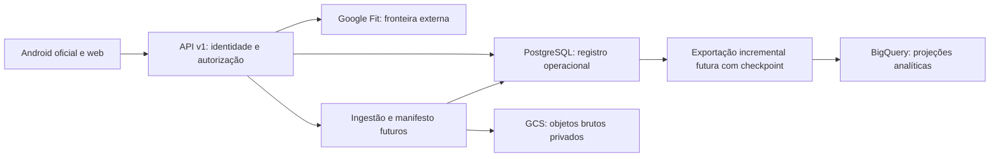

# ADR-0001 — Persistência operacional do Vytal (PKG-05, etapa 1)

- Data da análise: **2026-11-05**, America/Sao_Paulo.
- Estado: **proposto, pendente de aprovação**. Recomenda uma direção; não autoriza implementação, contratação, migração ou produção.
- Base auditada: `master` **aaa66829642c2506b25634797687cc231a1984b3** (PKG-03 integrado).
- Referência externa à base: [PKG-04, PR #21](https://github.com/giovanimarin/vytal/pull/21), relatório [no commit 0ac558b](https://github.com/giovanimarin/vytal/blob/0ac558b54a1aca2fd76738f01828fc0fdff2f1d3/docs/egm/11-pkg-04-deploy-readiness.md). Esse PR **não está na master auditada**; seus arquivos/correções não foram incorporados neste PR.
- Escopo desta etapa: inventário, alternativas, custos e plano. Somente documentação; nenhuma implementação de repositório, dependência, Terraform, configuração ou credencial alterada.

## 1. Contexto e requisitos de decisão

A API v1 atende autenticação, perfil, sincronização de saúde, readiness, feedback, treinos e recuperação. O mesmo `WarehouseProvider` é usado para leituras transacionais e dados analíticos. SQLite local aplica chaves/uniqueness; o adapter BigQuery usa `insert_rows_json` para inserts e jobs separados para consultas/DML. Esses contratos não são equivalentes.

A direção de produto já comunicada em D12 é PostgreSQL operacional, BigQuery quando necessário para análise e GCP para produção. Este ADR não reabre D12 nem escolhe silenciosamente um serviço externo. A escolha de serviço, topologia, região, disponibilidade, orçamento e tratamento de dados sensíveis ainda precisa ser aprovada. Não há volume medido, orçamento, RPO, RTO ou SLO aprovados; nenhum número desses será inventado como requisito.

Requisitos técnicos para a futura implementação:

- **P-01**: unicidade efetiva de identidade, credencial de refresh e chaves naturais; violações concorrentes tratadas sem corrupção ou troca de conta.
- **P-02**: rotação/revogação persistentes e consistentes entre processos/instâncias; um refresh consumido não pode gerar duas credenciais válidas. Não depender de mutex no processo ou sucesso de mock.
- **P-03**: isolamento por identidade validada no backend antes do acesso; consultas de exercícios precisam validar o treino proprietário. Clientes Android/web não recebem credenciais de banco.
- **P-04**: transações para unidades de trabalho que não podem ficar parcialmente gravadas; nenhuma transação deve manter locks durante chamada OAuth/Fit remota.
- **P-05**: contratos públicos v1, algoritmos/resultados existentes e semântica de erros legítimos preservados; diferenças inevitáveis exigem proposta explícita e revisão.
- **P-06**: durabilidade, recuperação e rollback comprovados antes de produção; não equiparar criptografia do disco a backup ou SLA.
- **P-07**: desenvolvimento local sem serviço pago; testes de concorrência no PostgreSQL real isolado antes de declarar paridade, mantendo SQLite e regressões existentes.
- **P-08**: total de custo e limites de conexão observáveis; nenhuma ativação de analítica/exportação paga por inferência.

## 2. Inventário integral — comportamento comprovado

Fonte primária do esquema: [`local.py`](../../../backend/app/adapters/cloud/local.py), constante `_SCHEMA_SQL`; operações em [`repositories/`](../../../backend/app/repositories/) e [`services/`](../../../backend/app/services/). **16 tabelas**. “Destino recomendado” é proposta, não estado atual.

| Tabela / entidade | Classe e operações atuais | Chaves, dependências e garantias necessárias | Destino recomendado |
| --- | --- | --- | --- |
| `users` — conta/perfil | Transacional; create, busca email/id, verificação de senha, update perfil (`user_repo.py`) | PK user_id; UNIQUE email; autenticação depende dela. Pré-consulta de email não evita corrida. Hash de senha, perfil e medidas são sensíveis | PostgreSQL, fonte de verdade |
| `refresh_tokens` — sessões | Transacional/segurança; create/get, rotate condicional, revoke e revoke_all (`refresh_token_repo.py`) | PK token_id; UNIQUE token_hash; user_id lógico→users; expiração aware UTC, revoked inteiro. CAS deve alterar exatamente uma linha; create→uso→logout não pode depender de streaming/visibilidade eventual | PostgreSQL; nunca BigQuery/GCS |
| `oauth_tokens` — autorização do provider | Transacional/segredo; save/get (`token_repo.py`) | PK composta (user_id, provider); users lógico; access/refresh tokens de provider e expires_at. Upsert e renovação consistentes; tokens não exportados a analytics | PostgreSQL com proteção de acesso/segredos; não BQ/GCS |
| `wellness_feedback` — autorrelato | Transacional; save/get (`wellness_repo.py`) | PK feedback_id; UNIQUE(user_id,date); users lógico; não sobrescrever outras contas. Upsert por chave natural precisa preservar intenção | PostgreSQL; exportação analítica minimizada só após aprovação |
| `workout_history` — treino | Transacional; save, histórico e recentes (`workout_repo.py`) | PK workout_id; users lógico; índice user_id/date; pai de exercícios e referência lógica da recuperação | PostgreSQL |
| `workout_exercises` — itens do treino | Transacional; save_batch/get (`workout_repo.py`) | PK exercise_id; **única FK declarada**: workout_id→workout_history. Sem user_id direto: ownership herdado do treino; conjunto deve ser atômico com pai | PostgreSQL |
| `raw_health_events` — evento do provider | Bruto; save/save_batch, leitura por conta/tipo/período (`health_data_repo.py`) | PK event_id; users lógico; provider, metric_type, raw_payload, collected_at, ingested_at, pipeline_run. Identidade do evento/deduplicação entre re-syncs precisa de contrato; UUID novo não prova idempotência | Primeiro PostgreSQL para paridade; depois objeto GCS + manifesto operacional, condicionado ao plano |
| `normalized_sleep` | Derivado/analítico consumido pela API; save/get (`health_data_repo.py`) | PK record_id; user_id/date; source_event_id lógico→raw. Sleep necessário ao readiness; não há UNIQUE(user_id,date) no DDL | PostgreSQL para leitura operacional; réplica analítica futura em BigQuery |
| `normalized_steps` | Derivado/analítico; save/get | PK record_id; user_id/date; source_event_id lógico; hourly_steps é TEXT/JSON atual | PostgreSQL + réplica BQ opcional |
| `normalized_activity` | Derivado/analítico; save/get | PK record_id; user_id/date/source_event_id; múltiplas atividades legítimas por dia, não impor UNIQUE diário indiscriminado | PostgreSQL + réplica BQ opcional |
| `normalized_heart_rate` | Derivado/analítico; save/get | PK record_id; user_id/date/source_event_id; necessário ao readiness; ausência de UNIQUE diário não autoriza deduplicação destrutiva | PostgreSQL + réplica BQ opcional |
| `normalized_stress` | Derivado/analítico; save/get | PK record_id; user_id/date/source_event_id; available inteiro, stress opcional; preservar ausência e dados existentes | PostgreSQL + réplica BQ opcional |
| `fact_daily_readiness` | Resultado derivado persistido, leitura operacional e histórico (`readiness_repo.py`) | PK readiness_id; UNIQUE(user_id,date); users lógico; contribuições, insight_text, calculated_at. Upsert/recalcular não deve reinterpretar histórico silenciosamente | PostgreSQL para v1; projeção BigQuery futura |
| `fact_readiness_by_modality` | Resultado derivado/recomendação (`modality_readiness_repo.py`) | PK record_id; UNIQUE(user_id,date,modality); users lógico; hrv_available e low_confidence inteiros | PostgreSQL + projeção analítica opcional |
| `muscle_recovery` | Estado derivado por músculo/data (`muscle_recovery_repo.py`) | PK record_id; UNIQUE(user_id,date,muscle_group); users lógico e last_workout_id lógico→workout_history; índice user_id/date | PostgreSQL + projeção analítica opcional |
| `dim_user` | Dimensão analítica; escrita no cadastro e conexão OAuth (`auth_service.py`, `health_data_repo.py`) | PK user_id; provider/created_at; relação lógica com users, sem FK declarada. Não é cadastro mestre; a PK atual permite um registro por conta, não por provider | Projeção derivada; manter compatibilidade operacional inicialmente; BQ opcional |

Dependências adicionais: `auth_service.py` encadeia users→dim_user→refresh_tokens; `oauth_service.py` grava oauth_tokens→dim_user após troca externa; `health_data_service.py` encadeia raw→normalização→readiness; `workout_service.py` grava pai→exercícios; serviços de modalidade/recuperação leem histórico e gravam resultados em lote. Catálogos de esportes/exercícios e definições de métricas são código estático, não novas tabelas. Jejum, histórico expandido de perfil, outbox, sync_runs, manifesto de blobs e ledger de migração **não existem no esquema atual**; outbox, sync_runs, manifesto e ledger, se adotados, serão infraestrutura técnica proposta, não funcionalidade aprovada nesta etapa.

### Limites reais de integridade e atomicidade

- Existem cinco índices nomeados adicionais: email, refresh por usuário, treino por usuário/data, recuperação por usuário/data, modalidade por usuário/data; além dos índices implícitos de PK/UNIQUE. Ausência de índice não equivale à ausência de chave.
- As relações com users/source_event/last_workout são **lógicas**, não FKs hoje. Só exercícios declara FK; `LocalWarehouseProvider` não habilita `PRAGMA foreign_keys=ON`. Portanto, nem essa declaração prova enforcement na execução atual.
- `insert()` local usa `INSERT OR REPLACE`, uma semântica de substituir linha que não deve ser traduzida cegamente para INSERT PostgreSQL. Cada chamada abre conexão/commit separados. `save_workout` + `save_exercises`, cadastro completo e ingestão completa **não têm unidade de transação compartilhada** hoje.
- O CAS de refresh é um UPDATE único com predicados hash/conta/revoked/expiry e contagem afetada; as regressões PKG-02 provam concorrência SQLite, não BigQuery. Logout não revoga automaticamente todos os access JWT já emitidos; não mudar essa política incidentalmente na migração.
- O PKG-04 detectou dez tabelas locais ausentes no Terraform BQ, `raw_google_fit_events` com nome/shape diferentes de raw_health_events, dim_user exigindo date ausente, SDK/config/IAM incompletos e risco streaming→DML. Mesmo corrigir o JSON de refresh não estabelece unicidade nem concorrência. PK/FK BigQuery NOT ENFORCED e insertIds best-effort não substituem transação/constraint.

| Unidade futura | Garantia alvo a validar | Tratamento proposto, sem implementação |
| --- | --- | --- |
| Cadastro concorrente | Uma conta por email sob semântica atual; erro compatível e rollback completo se falhar passo obrigatório | UNIQUE + transação para dados operacionais; decidir se dim_user sai do caminho crítico via projeção confiável |
| Refresh e logout concorrentes | Sem ressurreição/duplo refresh após consumo; falha de commit não publica credencial | UPDATE condicional transacional, hash único; teste multi-conexão e corrida com revoke/revoke_all |
| OAuth save/renovação | Um vínculo por conta/provider, consistência de expiração e segredo | UPSERT por chave composta; chamada remota antes da transação, política de falha/retry explícita |
| Treino e exercícios | Todos os itens ou nenhum; conta de pai validada no backend | Unidade de trabalho e FKs efetivas; falhas injetadas no segundo passo |
| Feedback e resultados diários | Uma linha por chave natural atual, sem REPLACE destrutivo | ON CONFLICT com regra por entidade, preserving IDs/referências e isolamento |
| Ingestão/re-sync | Sem afirmar exactly-once; recuperação rastreável de etapa parcial | Definir identidade/dedup por fonte e job/checkpoint; não manter transação longa durante fetch remoto ou escrita GCS |
| Exclusão e projeções | Não deixar cópias órfãs ou restaurar dados excluídos | Plano de deleção, tombstone e reprocessamento aprovado; não inventar prazo/retention |

## 3. Alternativas e comparação

A = PostgreSQL Cloud SQL no GCP; B = PostgreSQL externo **Neon** como representante concreto de Free/Launch/Scale; C = SQLite local inicialmente com evolução planejada. Nenhuma conta/recurso foi criado, nenhum serviço foi acessado com credenciais.

| Critério | A — Cloud SQL PostgreSQL | B — Neon PostgreSQL | C — SQLite inicialmente |
| --- | --- | --- | --- |
| Custo mensal | Base sempre ligada, compute + disco + backup + rede; HA aumenta custo. Estimativas condicionais §4; não há promessa de free tier permanente | Free sob cotas, sem SLA; Launch medido por CU-h e storage, com hibernação; rede entre GCP/AWS custa e pode aumentar latência | Licença US$0 e desenvolvimento local sem nova hospedagem. Produção durável exige host/disco/backup/operação pagos; não declarar US$0 de infraestrutura |
| Disponibilidade/persistência | Banco gerenciado durável; single-zone não é HA; SLA e failover dependem da edição/topologia/região contratadas | Compute pode suspender, armazenamento persiste segundo serviço; retomada tem latência. Free/Launch sem SLA publicado na fonte consultada; Scale oferece SLA sujeito a termos | Arquivo durável apenas em disco persistente do host; host único é ponto de falha. Arquivo no filesystem gravável do Cloud Run é efêmero |
| Segurança/isolamento | IAM do serviço/conector, roles SQL mínimas, TLS e políticas de rede; autorização por conta ainda obrigatória | TLS verificando certificado/hostname, roles mínimas e segredo server-side; conexão pública/pooling não substitui autorização. Contrato/LGPD/residência/subprocessadores fora do GCP precisam aprovação | Backend único controla acesso ao arquivo; permissões/criptografia do host e backup por conta do operador. Sem isolamento multi-tenant automático |
| Backup/recuperação | Configurar backups/PITR e retenção conforme produto contratado; restauração ensaiada. HA não é backup | História/restore variam pelo plano; Free tem janela curta e não é backup independente. Planejar export protegido e teste de restauração/saída | Backup consistente por API SQLite/backup online; com WAL, não copiar apenas db em uso. Operador armazena/restaura/valida; snapshot não prova integridade |
| Concorrência/transações | ACID, PK/FK/UNIQUE aplicadas, locks/MVCC e CAS entre instâncias; desenhar isolamento e retries limitados | PostgreSQL com as mesmas primitivas básicas; pooling e suspensão afetam conexão/sessão, não autorizam enfraquecer transações | ACID local; múltiplos leitores, escrita serializada/um escritor por vez; locks/busy exigem tratamento. WAL não é replicação nem HA |
| Cloud Run | Integração com Cloud SQL connector/socket ou caminho privado aprovado; limitar pool por instância e total de instâncias | TLS via endpoint externo/pooler, custo e latência intercloud, reconnect; sem credenciais no Android/web | **Não recomendado** para produção Cloud Run: instâncias/revisões não compartilham arquivo durável. max_instances=1 não evita perda de disco/revisões concorrentes; GCS/FUSE não fornece locks POSIX de SQLite |
| Operação | Gerenciado, mas demanda sizing, conexões, manutenção, IAM, backup e observabilidade | Menos infraestrutura própria; gerenciar cotas/billing, cold starts, pooler, exportabilidade e fornecedor | Simples local; produção exige host stateful, patch, disco, backup, recuperação e coordenação de escritor. Não é “serverless sem custo” |
| Escala | Aumentar tier, replicas para leituras compatíveis, HA; não escalar sem medir | Autoscale/upgrade conforme plano; conexões/compute/egress cobrados e limites mudam | Limite prático depende da carga de escrita/latência/disco, não de número inventado de usuários; migrar antes de múltiplos escritores distribuídos |
| Desenvolvimento local | PostgreSQL local/container gratuito e SQLite mantido; serviço gerenciado não é necessário para CI | Mesmo PostgreSQL local; CI sem depender de plano grátis ou endpoint público | Excelente desenvolvimento/testes rápidos; adicionar testes reais PostgreSQL porque dialetos/constraints diferem |

As fontes técnicas atuais do Neon indicam PgBouncer em transaction pooling: sessão SQL não pode ser tratada como conexão dedicada. Transações explícitas devem conter suas operações na mesma conexão; contexto de conta não pode vazar entre clientes de pool. Não introduzir RLS com `SET` de sessão persistente como solução automática. RLS pode ser defesa adicional futura, com transaction-local context, testes de reuse do pool e papel que não bypassa políticas; não substitui P-03 nem está aprovado/implementado aqui. Migração/pg_dump devem usar caminho direto apropriado, não assumir suporte via pooler.

## 4. Estimativas mensais, fontes e limites

Consulta em **2026-11-05**; USD, sem conversão para BRL/impostos/descontos/compromissos. Cenários usam **730 h/mês** apenas para estimativa. Capacidades e volumes abaixo são **hipóteses de cálculo**, não limites, orçamento ou sizing aprovados. Não somar componentes já incluídos no plano nem assumir tráfego gratuito entre provedores.

### A — Cloud SQL, região us-central1

A política de rede permite GitHub/raw, mas não disponibiliza consulta direta ao catálogo oficial cloud.google.com nesta execução. **Não há cotação oficial atual validada.** Para dar ordem de grandeza rastreável, usam-se os valores do fixture público Infracost [S4/S5], com configuração us-central1, PostgreSQL 15 e 10 GB SSD. É uma **fonte secundária de teste**, consultada em 2026-11-05, sem data de vigência do tarifário; pode estar desatualizada, conter simplificações ou tiers não elegíveis. **Não é proposta comercial nem autorização de gasto.** Revalidar edição/versão/suporte estendido/SLA/tier/região, preços e elegibilidade no [tarifário oficial](https://cloud.google.com/sql/pricing) antes de escolher serviço. Não chamar a tabela abaixo de preço oficial de 2026.

| Cenário ilustrativo, us-central1 | Compute do snapshot/730 h | SSD/10 GB | Backup suposto 10 GB × US$0,08 | Subtotal estimado de referência |
| --- | ---: | ---: | ---: | ---: |
| db-f1-micro zonal, somente comparação econômica, sem inferir SLA/adequação | 7,67 | 1,70 | 0,80 | **US$10,17/mês** |
| db-g1-small zonal, mesmas ressalvas | 25,55 | 1,70 | 0,80 | **US$28,05/mês** |
| db-custom-1-3840 zonal (1 vCPU/3,75 GB) | 30,15 + 19,16 | 1,70 | 0,80 | **US$51,81/mês** |
| db-custom-2-7680 zonal (2 vCPU/7,5 GB) | 60,30 + 38,33 | 1,70 | 0,80 | **US$101,13/mês** |
| db-custom-2-7680 regional, referência HA | 120,60 + 76,65 | 3,40 | 0,80 | **US$201,45/mês** |

Subtotais **não são custo total**: acrescentar armazenamento/backup efetivos, crescimento automático, WAL/PITR conforme cobrança, replicas, rede/egress, conectividade privada/egress estático/NAT se escolhidos, logs, suporte e componentes de Cloud Run. O fixture também indica **US$7,30/mês para endereço IP se não utilizado**; é condicional, não somado automaticamente nem prometido gratuito. Não escolher shared-core para produção por ser mais barato sem validar suporte, carga e recuperação. Nenhum tier está aprovado.

Modelo a cotar: `730 × compute_hora(topologia, região, edição) + GB_disponibilizados × disco_mês + GB_backup_faturáveis × backup_mês + PITR/replicas/rede/conectividade/logs`, evitando dupla contagem conforme contrato. Custo de Cloud Run/BigQuery/GCS é separado.

### B — Neon, região candidata AWS us-east-1 (N. Virginia)

[S1/S2] são documentação **oficial** versionada do provedor consultada em 2026-11-05; plans foi atualizado em 2026-11-04. A tabela publica tarifas gerais por plano, não diferencia us-east-1; essa região consta na lista de regiões [S2]. Confirmar tarifa/região no momento da contratação. Não se afirma que o banco está no GCP/us-central1 ou que tenha região brasileira.

- Free: **US$0/mês de serviço dentro das cotas publicadas**: 100 CU-h/mês por projeto, 1 GB/projeto (20 GB total por conta), 5 GB de transferência pública/projeto, suspensão após 5 min e restore de até 6 h/1 GB de alterações. A 0,25 CU, 100 CU-h equivalem a 400 h ativas, não 730 h de operação contínua. Sem SLA. Cotas/condições podem mudar ou interromper o uso; não são garantia permanente de produção gratuita.
- Launch: **US$0,106/CU-h + US$0,35/GB-mês de storage + US$0,20/GB-mês de histórico de restore**; sem mínimo mensal na fonte. Transferência pública inclui 500 GB/projeto e excedente US$0,10/GB; snapshots manuais US$0,09/GB-mês e branches adicionais cobradas conforme fonte. Não habilitar snapshots/branches extras/serviços opcionais por inferência. Restore e armazenamento têm bases de medição próprias; “histórico 1 GB” abaixo é hipótese faturável, não o tamanho garantido de um backup.
- Hipótese Launch intermitente: 0,25 CU × 100 h ativas × 0,106 + 1 GB × 0,35 + 1 GB histórico × 0,20 = **US$3,20/mês**, antes de rede GCP e extras.
- Hipótese Launch contínuo: 0,25 CU × 730 h × 0,106 + 0,35 + 0,20 = **US$19,90/mês** arredondado; se autoscale/keepalive/pool impedir suspensão, o cenário intermitente deixa de valer. Free/Launch não têm SLA na fonte consultada.
- Scale: referência **US$0,222/CU-h**, mesmos US$0,35/GB e US$0,20/GB de histórico; 0,25 CU continuamente + 1 GB + 1 GB dá **US$41,07/mês**, antes de adicionais. Existência de SLA não define seus termos ou adequação ao Vytal.

Esses números **não incluem** egress cobrado pelo GCP no sentido Cloud Run→Neon, eventual endereço de saída/NAT, observabilidade externa, backups independentes, impostos ou serviços opcionais. Região distante e tráfego de saúde podem alterar custo/latência/conformidade. Não cadastrar dados reais antes de aprovação de contrato/residência/subprocessadores.

### C — SQLite local e hospedagem stateful

Região do cenário gratuito: **máquina local do desenvolvedor**, não GCP. Licença de software **US$0** [S6]; usando hardware existente, nenhuma contratação mensal nova para desenvolvimento, sem atribuir custo zero a energia, disco, tempo operacional ou backup. Produção em host stateful não tem região/tier/provedor escolhidos: **estimativa monetária indisponível, não US$0**. Modelo: `host + disco persistente + backup externo + rede + logs + operação/recuperação`. Cloud Run filesystem efêmero não é alternativa de armazenamento gratuito seguro; volume GCS/FUSE não é um banco transacional. Qualquer proposta de VM/disco/replicação requer nova cotação/decisão, não está autorizada.

### Componentes comuns que não podem sumir da conta

Além do banco: Cloud Run (compute/requests conforme modo), Secret Manager, rede/egress, logs, backups externos e operação. Se forem aprovados, GCS cobra armazenamento por classe/região, operações, recuperação e possíveis mínimos/early deletion; BigQuery cobra armazenamento e consultas/processamento conforme modelo contratado. Não habilitar nenhum deles para obter preços ou assumir free tier. Esses componentes não têm volume nem cotação oficial regional validada nesta execução: permanecem variáveis abertas do custo total, não incluídas nos subtotais. Conferir também o lifecycle já declarado no Terraform contra a política legal/restore antes de copiar backups. Um orçamento do banco não é orçamento completo do Vytal.

### Registro de fontes

| ID | Fonte consultada | Região/escopo e data | Confiança/limite |
| --- | --- | --- | --- |
| S1 | [Neon plans oficial, commit 6e38b0a](https://github.com/neondatabase/website/blob/6e38b0ab6f7ac21db2aa9c0b7b358d14daed8ae9/content/docs/introduction/plans.md) | Tarifas gerais publicadas, consulta 2026-11-05; atualização indicada 2026-11-04 | Fonte primária; não congela contrato/preço futuro |
| S2 | [Neon regions oficial](https://github.com/neondatabase/website/blob/6e38b0ab6f7ac21db2aa9c0b7b358d14daed8ae9/content/docs/introduction/regions.md) | Candidato aws-us-east-1; consulta 2026-11-05 | Região fixa por projeto; mudança exige projeto/migração; sem projeto criado |
| S3 | [Neon connection pooling oficial](https://github.com/neondatabase/website/blob/6e38b0ab6f7ac21db2aa9c0b7b358d14daed8ae9/content/docs/connect/connection-pooling.md) | Geral; consulta 2026-11-05 | Prova documental, não teste de serviço ou SLA |
| S4 | [Infracost fixture de custo, commit 93b9a2d](https://github.com/infracost/infracost/blob/93b9a2d921f19966b09a3d84d2e63bd86f8587d0/internal/providers/terraform/google/testdata/sql_database_instance_test/sql_database_instance_test.golden) | Cloud SQL; consulta 2026-11-05; vigência de preços desconhecida | Fonte secundária/teste; estimativa condicional, cotação oficial pendente |
| S5 | [Configuração do fixture Infracost](https://github.com/infracost/infracost/blob/93b9a2d921f19966b09a3d84d2e63bd86f8587d0/internal/providers/terraform/google/testdata/sql_database_instance_test/sql_database_instance_test.tf) | us-central1 / POSTGRES_15 / zonal e regional; consulta 2026-11-05 | Lido como texto, nunca executado; não copiar suas configurações para produção |
| S6 | [SQLite licença oficial](https://github.com/sqlite/sqlite/blob/master/LICENSE.md) | Software local; consulta 2026-11-05 | Domínio público/licenciamento, não garantia de custo de operação zero |

Não se consultou API de billing, conta, credencial, calculadora autenticada ou serviço pago. As limitações de fonte são bloqueios de contratação, não motivo para inventar tarifas. O uso de PostgreSQL local mantém a validação independente de planos gratuitos.

## 5. Arquitetura recomendada — proposta

**Recomendar PostgreSQL como única fonte de verdade operacional, Cloud SQL como hospedagem preferencial para produção GCP**, condicionada a orçamento, região/topologia, segurança e recuperação aprovados. Não aprovar um tier neste ADR; HA vs zonal depende de RPO/RTO/SLO e testes, não apenas de custo. Reduzir custo evitando duplicação analítica prematura, dimensionando por carga e limitando conexões, sem enfraquecer durabilidade/isolamento.

**Neon Launch é a alternativa de baixo custo a submeter ao PO** se Cloud SQL exceder o orçamento: não há aprovação automática para mover dados de saúde fora do GCP/D12. Free é candidato só para avaliação com dados sintéticos e local continua gratuito; não usar free tier como requisito de disponibilidade. Se residência, SLA ou contrato não forem aceitos, descartar alternativa externa. **SQLite permanece suporte local e transição controlada**, sem liberar produção Cloud Run com disco efêmero. Se nem Cloud SQL nem externo forem aprovados, manter desenvolvimento local e produção bloqueada; não improvisar banco em GCS.

| Componente | Responsabilidade proposta | O que não deve depender dele |
| --- | --- | --- |
| PostgreSQL | Contas, sessões, tokens OAuth, feedback, treinos/exercícios; dados normalizados/resultados necessários à resposta v1; unicidade, FK, transação, ownership, metadados/manifests/checkpoints futuros | Login/refresh não dependem de exportador, BigQuery ou GCS estar disponível |
| BigQuery | Cópias minimizadas de eventos/normalizados/resultados para análises pesadas quando justificadas; dataset/partições por coluna real e jobs com orçamento | Não é fonte autoritativa de sessão, perfil, escrita transacional ou autorização. Não recebe password_hash, token_hash, tokens OAuth ou secrets |
| GCS | Objetos brutos imutáveis/versionados conforme política aprovada, checksums e referências operacionais; snapshots/export backups somente se política permitir | Não armazena arquivo SQLite compartilhado; objeto disponível não significa transação PG concluída ou backup restaurável |
| Aplicação/worker | Autorização no backend, regras de negócio, reprocessamento rastreável, exportação com idempotência observável | Sem dual-write síncrono ingênuo PG+BQ/GCS nem promessa de exactly-once entre sistemas |

Primeiro atingir paridade das 16 tabelas em PostgreSQL; manter raw_health_events/normalizados/resultados acessíveis para os repositórios atuais antes de qualquer offload. Só depois propor outbox/checkpoint/manifesto e política de retenção/cópias. Falha de BQ pode atrasar análise, não invalidar cadastro. Para GCS, protocolo de estágio→confirmação/checksum e reconciliação de órfãos precisa desenho e testes próprios, pois não há commit distribuído PG+GCS. Preservar rastreabilidade/dedup e propagação de exclusão inclusive em backups/exportações conforme política legal aprovada.

## 6. Estratégia incremental de evolução e migração — não executada

Plano detalhado em [pkg-05-execution-plan.md](../pkg-05-execution-plan.md). Não executar DDL/backfill com este PR.

1. Congelar evidências v1/baseline e caracterizar constraints, operações e compatibilidade dos resultados atuais. Ler dados reais só em futura tarefa autorizada, com inventário protegido de duplicatas/órfãos; aqui apenas esquema e fixtures.
2. Separar contratos de persistência operacional e analítica sem alterar handlers públicos. Introduzir unidade de trabalho/injeção por serviço, preservando assinaturas públicas; não usar `provider=gcp` como sinônimo de “todos os dados em BigQuery”.
3. Definir mapa de tipos explícito (TEXT data→DATE, instantes→TIMESTAMPTZ/UTC, JSON text→JSONB ou conversão compatível, revoked/int→tipo com adaptação explícita). Decidir semântica de email/case, IDs, nullable/defaults e upsert sem mudar regra silenciosamente. Adicionar constraints após lidar com dados incompatíveis, sem descartar registros.
4. Implementar/testar PostgreSQL **local** por domínio, com SQLite como regressão. Migrações versionadas e rollback em fixtures, código e aprovação separados. Testar conexões reais distintas para CAS, unicidade, rollback e ownership.
5. Preferir cutover com janela de escrita suspensa e snapshot consistente, mediante aprovação de indisponibilidade. Alternativa sem janela exige journal/replicação/dual-write reconciliável e outro desenho aprovado; não ativar dois writers independentes. Fazer ensaio sintético e inventário de consistência protegido antes de dados reais.
6. Durante futura migração autorizada preservar IDs e referências, hashes de senha/refresh existentes, instantes, TTL/estado de revogação e configurações de assinatura por referências privadas; nunca restaurar token antigo válido ao reverter. Não copiar segredos para ADR/logs/BQ. Validar counts/checksums por tabela e conta, constraints, orfandade, amostras funcionais autorizadas e CAS antes de trocar fonte.
7. Mudar leitura/escrita juntas por fronteira de dados consistente, com caminho explícito de compatibilidade; nenhuma escolha pelo cliente/user_id. Após PostgreSQL aceitar novas escritas, rollback de imagem sozinho não pode voltar ao SQLite desatualizado. Restaurar fonte/ledger consistente ou interromper escritas e reconciliar segundo plano aprovado.
8. Analítica e GCS são entregas posteriores e opcionais, com contratos de exportação, dedup/replay, privacidade, exclusão e custo. Paridade v1 não depende de ativá-las. Jejum e outras novas features ficam fora desta migração.

## 7. Decisões e pré-requisitos para aprovação

| ID | Responsável / decisão | Bloqueia |
| --- | --- | --- |
| AP-01 | PO aprova/rejeita ADR e hospedagem: Cloud SQL preferencial; externo é exceção explícita a avaliar frente a D12 | Contratação/integração de serviço e desenho específico de rede |
| AP-02 | PO define teto mensal, moeda/impostos e margem; engenharia obtém cotação oficial datada/regional/edição e estima egress, disco, backup e carga | Provisionamento ou alegação de custo total; fixture não é cotação |
| AP-03 | PO/privacidade define residência, uso de fornecedor externo, condições para dados de saúde, acesso/subprocessadores e exclusão/retention legal | Dados reais em qualquer serviço/replicação/backup |
| AP-04 | PO/operação define disponibilidade, RPO/RTO, janela de manutenção e se cutover pode pausar escrita; engenharia propõe HA, backup, restore e rollback compatíveis | Topologia de produção e migração real |
| AP-05 | Engenharia propõe tipos/constraints/upserts, unidade de trabalho, driver/pool, limites e retries a partir de testes; regras de email/dedup não estabelecidas voltam ao PO | Paridade e implementação correspondente; não inventar políticas de produto |
| AP-06 | Segurança/operação aprova identidade runtime/migração separadas, rede/TLS/secrets e acesso mínimo | Uso de infraestrutura/autorização real; nenhuma credencial acessada aqui |
| AP-07 | Revisores decidem integração do PKG-04 e revalidam seus gaps no SHA efetivamente aprovado | Não presumir que suas correções já existem na master |

Riscos principais: custo mínimo gerenciado vs orçamento desconhecido; ausência de SLA/cotas mutáveis em free; egress/latência/residência externos; perda do arquivo SQLite efêmero; explosão de conexões Cloud Run; vazamento de contexto de pool; alteração de semântica por REPLACE/tipos/FKs; dados atuais duplicados/órfãos não examinados; parcialidade de cadastro/treino/ingestão; restauração que ressuscita sessão ou perde novas escritas; custos/copias/exclusão em analytics. Sem evidências de restauração e concorrência PostgreSQL real, não declarar a migração pronta.

## 8. Verificações desta etapa

Somente leitura de fonte, extração AST do DDL, SQLite **em memória** para enumerar tabelas/chaves/índices e conferência de referências/aritmética/documentação. Nenhum dado da aplicação, `.env`, credencial, tfstate ou banco real foi lido. Nenhum teste de integração remoto, deploy, apply, serviço pago ou migração executado. Implementação e testes de PostgreSQL descritos acima são futuros, não resultados desta etapa.

Verificação documental executada: 16/16 tabelas cobertas, cinco índices nomeados e uma FK declarada conferidos por DDL AST/SQLite em memória; referências locais e blocos Markdown válidos; oito cenários monetários recalculados com Decimal e arredondamento explícito; `git diff --check` sem erros. Não foram executados builds ou testes funcionais locais, pois não há alteração funcional nesta etapa. CI automático, se disparado pelo push/PR, é evidência separada e não comprova preço, SLA ou banco gerenciado real.
